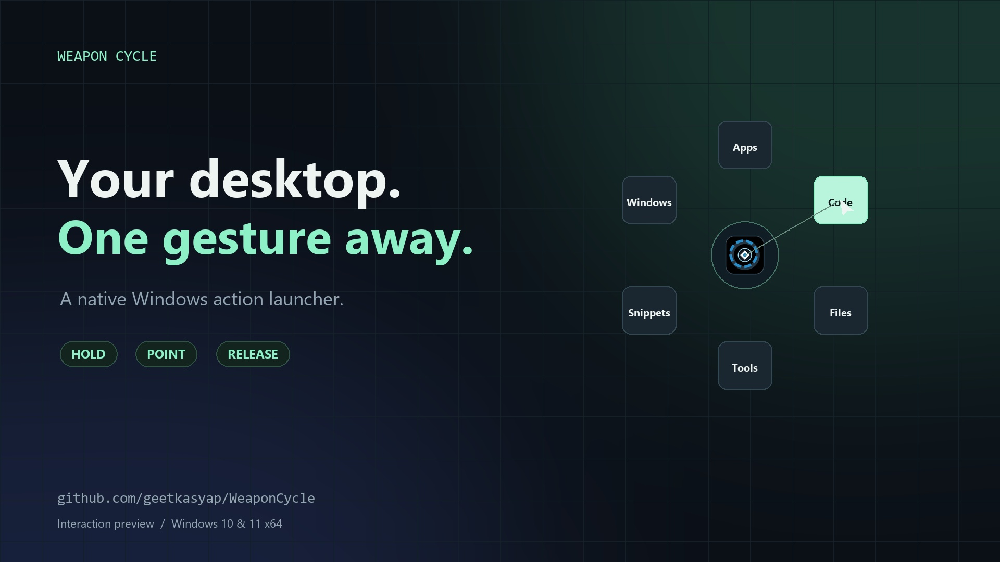

<p align="center"></p>
<h1 align="center">Weapon Cycle</h1>
<p align="center"><strong>Your desktop. One gesture away.</strong><br>A blazing-fast, open-source radial launcher for Windows. Hold. Point. Release.</p>

<p align="center">
  <a href="https://github.com/geetkasyap/WeaponCycle/releases/latest"></a>
  
  
  
  
  
</p>

<p align="center">
  <a href="docs/media/brag.mp4"></a><br>
  <a href="docs/media/brag.mp4"><strong>▶ Watch the 20-second demo</strong></a>
</p>

---

**Hold `Shift+Space`. Point. Release.** Open an app, jump into a submenu, paste a snippet, or fire a developer tool, without ever touching the Start menu or another search box. Your muscle memory does the rest.

## ⚡ Works on your work laptop too

Most launchers want an installer, a background service, or admin rights. Weapon Cycle wants none of them.

| | |
|---|---|
| 🧳 **Truly portable** | A single ~1.2 MB native `.exe`. Unzip it into any folder you own and run it. |
| 🔓 **No admin rights** | Runs as a normal user (`asInvoker`). No UAC prompt, no elevation, ever. |
| 🧩 **No dependencies** | Links only to built-in Windows system DLLs. No .NET, no VC++ redistributable, no Electron, no browser. |
| 🧼 **Leaves no trace** | No installer, no service, no driver, no registry tricks. Delete the folder and it's gone. |
| 🪶 **Featherweight** | Event-driven and idle-quiet. It sits in the tray and wakes only when you hold the hotkey. |
| 🌍 **Open source** | Every line is right here under the MIT license. Read it, build it, fork it. |

So it runs on home PCs, gaming rigs, and locked-down office laptops alike.

> Using a managed company device? Weapon Cycle needs nothing special, but please still follow your organisation's software policy.

## ✨ What it does

| Feature | |
|---|---|
| 🎯 **One learned gesture** | Hold, point, release. `Esc` or right-click cancels. `1`–`9` for instant picks. |
| 🗺️ **Your own action map** | Apps, commands, URLs, files, folders, snippets, keyboard shortcuts and nested submenus. |
| 🎨 **Native preferences** | Drag to rearrange, auto-discover installed apps, tune appearance and pick your hotkey. |
| 🛠️ **Developer bench** | JSON, Base64, GUID, JWT, hashing, regex, text diff and more, all local and offline. |
| 🔄 **Optional file conversion** | An on-demand conversion helper for documents and images. |
| 🖥️ **Crisp everywhere** | Direct2D/DirectComposition rendering, per-monitor DPI aware, smooth animations. |

## 🚀 Get started in 30 seconds

1. Download the latest `WeaponCycle-*-win-x64-portable.zip` from **[Releases](https://github.com/geetkasyap/WeaponCycle/releases/latest)**.
2. Unzip anywhere, e.g. `Documents\Tools\WeaponCycle`.
3. Run `OrbitDeck.exe`. Preferences open so you can build your wheel.
4. Hold **`Shift+Space`** anywhere. That's it.

Want it at login? Run it with `--background` from your Startup folder for a quiet tray start.

## 🔧 Build from source

Install Visual Studio 2022 with **Desktop development with C++**, a Windows SDK, and CMake 3.25+.

```powershell
cmake --preset windows-release
cmake --build --preset windows-release
ctest --preset windows-release
.\out\build\windows-release\Release\OrbitDeck.exe
```

For Visual Studio 2026, use the matching `windows-2026-release` preset and CMake 4.2+. The native build is independent of the optional .NET conversion helper; see [the technical guide](docs/technical-guide.md#complete-portable-converter) for the full portable package and [the architecture notes](docs/architecture.md) for how it all fits together.

## 🤝 Contribute

Ideas, bugs and pull requests are all welcome. Start with [CONTRIBUTING.md](CONTRIBUTING.md). Bug reports should include your Windows version, build configuration and reproduction steps. Please don't attach private configurations or credentials.

If Weapon Cycle saves you a few seconds a day, a ⭐ helps other people find it.

## 📄 License

Released under the [MIT License](LICENSE). Optional engines and dependencies keep their own terms; see [THIRD_PARTY_NOTICES.md](THIRD_PARTY_NOTICES.md).